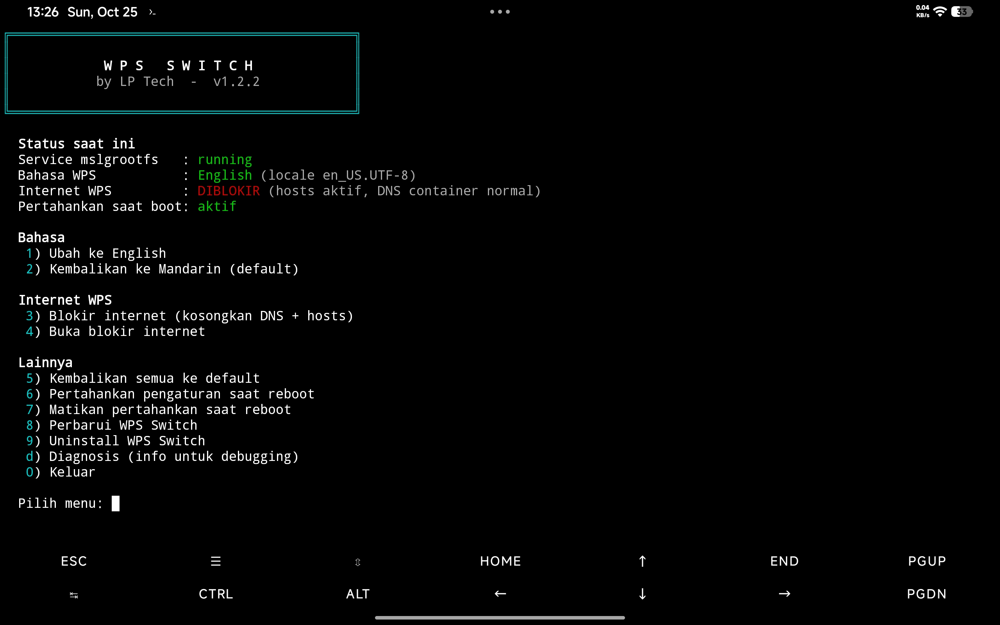

# WPS Switch by LP Tech



Atur **bahasa** dan **internet** WPS PC di Xiaomi Pad 5 (nabu, ROM HyperOS port) lewat satu perintah: `ws`.

- Ubah WPS dari Mandarin ke **English** (dan balik lagi)
- **Blokir internet WPS** supaya halaman login tidak muncul
- Kembalikan semua ke **default** kapan saja

> Memblokir internet tidak membuka fitur berbayar. Fitur online WPS (cloud, template online) ikut tidak tersedia.

## Yang dibutuhkan

- Root **KernelSU/Magisk** aktif, dan Termux sudah diizinkan di KernelSU/Magisk → Superuser
- **Termux** dari [F-Droid](https://f-droid.org/packages/com.termux/) (bukan Play Store)
- `curl` (`pkg install curl`)
- **Koneksi internet** saat membuka `ws` (lisensi diperiksa setiap kali dibuka)
- WPS PC sudah dibuka **sekali**

## Pasang

Di Termux, jalankan:

```bash
curl -fsSL https://raw.githubusercontent.com/lptech22/wps-switch/main/install.sh | bash
```

Instalasi meminta **kunci lisensi** (format `WPS-XXXX-XXXX-XXXX`). Satu lisensi berlaku untuk satu perangkat. Belum punya? Hubungi admin atau lewat link berikut https://lynk.id/lptech

Setelah terpasang, buka menunya dengan:

```bash
ws
```

## Cara pakai

Ketik `ws`, lalu pilih nomor menu:

| Menu | Fungsi |
|---|---|
| 1 | Ubah ke English |
| 2 | Kembali ke Mandarin |
| 3 | Blokir internet WPS |
| 4 | Buka blokir internet |
| 5 | Kembalikan semua ke default |
| 6 / 7 | Pertahankan pengaturan saat reboot: aktifkan / matikan |
| 8 | Uninstall |
| d | Diagnosis |

Setelah mengubah pengaturan, **tutup WPS dari recent apps lalu buka lagi**.

Tanpa menu, bisa langsung:

```bash
ws en        # English
ws zh        # Mandarin
ws block     # blokir internet
ws unblock   # buka blokir
ws reset     # kembali ke default
ws status    # lihat kondisi
ws help      # semua perintah
```

## Setelah reboot

Setelah tablet dimatikan, pengaturan bisa kembali ke default (WPS Mandarin, internet terbuka). Ada dua cara mengatasinya:

- **Otomatis (disarankan):** jalankan `ws en` dan `ws block` sekali, lalu pilih menu **6** (atau `ws boot-on`). Setiap boot, pilihan terakhirmu diterapkan lagi. Tunggu sekitar 1 menit setelah boot, lalu cek dengan `ws status`.
- **Manual:** jalankan lagi `ws en` dan `ws block` setelah reboot.

Kalau pilihan terakhirmu sedang tidak aktif, `ws status` akan memberi tahu.

## Kalau ada masalah

- `Akses root ditolak` → buka KernelSU → Superuser → izinkan Termux.
- WPS tidak mau terbuka → jalankan `ws reset`.
- Masih ada teks Mandarin → itu keterbatasan paket bahasa bawaan WPS.
- `Ditolak server` → lisensi dicabut atau dipakai di perangkat lain. Hubungi LP Tech.
- Hal lain → jalankan `ws debug` dan kirim hasilnya.

## Uninstall

```bash
ws uninstall
```

Tool akan menawarkan mengembalikan WPS ke default terlebih dahulu.

### Perangkat yang Sudah Diuji

| Perangkat | Versi ROM / HyperOS | Android | Status |
|:---|:---|:---:|:---:|
| Xiaomi Pad 5 | HyperOS 3.0.304.0 (Port Redmi Pad Pro) | Android 16 | ✅ |
| Xiaomi Pad 6 | HyperOS 2.0.20.0 | — | ✅ |

**Catatan:** Kompatibilitas dapat berbeda tergantung ROM, versi build, dan konfigurasi perangkat. ROM atau build lainnya mungkin memiliki hasil yang berbeda.

Semangat untuk berkarya 👋
